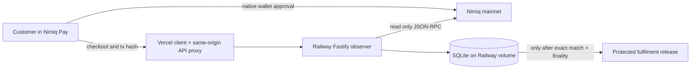

# OrderSeal

OrderSeal is a Nimiq Pay Mini App for merchants who need settlement evidence before releasing a digital fulfilment. It binds one server-authenticated order revision to an exact NIM mainnet recipient, Luna amount, expiry, and public operation reference; a backend observer then verifies the authoritative transaction and releases the protected fulfilment exactly once after the configured confirmation threshold.

This repository contains a working product, not a simulated checkout. The wallet path calls `@nimiq/mini-app-sdk` `sendBasicTransactionWithData`; the backend reads Nimiq mainnet independently through JSON-RPC; SQLite persists orders, operations, observations, audit events, and fulfilment fences.

## What is implemented

- Mainnet-only NIM order creation with decimal-safe NIM-to-Luna conversion.
- HMAC-sealed order terms, including a digest of the protected fulfilment payload.
- Nimiq Pay SDK transaction request with the exact recipient, value, and operation reference.
- Full-checkout-URL Nimiq Pay handoff from a regular browser, plus share/copy fallback.
- Server-side `getTransactionByHash` and `getBlockNumber` verification through one configured, trusted RPC.
- Exact checks for hash, execution result, network ID, recipient, amount, operation reference, and sealed expiry.
- Durable `PAYMENT_OBSERVATION_UNKNOWN` and retry fencing when chain outcome is unavailable.
- Public hashes remain attempt evidence until an exact chain match atomically promotes one canonical payment authority; bogus first hashes cannot pin an order.
- Wallet outcome-unknown errors recover and observe an SDK-provided staged hash; when no valid hash exists, retry stays disabled until the customer explicitly confirms checking wallet history.
- The observer loop never overlaps itself, and concurrent manual/background reconciliation for one payment authority shares one in-flight RPC read.
- One canonical payment operation and one fulfilment authority per order, enforced by database constraints and version-CAS transitions.
- Immutable terminal states: a late callback or second hash cannot regress a fulfilled, refunded, or conflicted order.
- Responsive merchant console, public checkout, finality evidence, conflict states, and keyboard-visible controls.
- Split hosting: Vercel serves the client and same-origin API proxy; Railway runs the persistent Fastify observer with a mounted SQLite volume.

## Honest boundary

OrderSeal currently supports NIM only. It does not hold merchant keys, send refunds, or claim a refund succeeded. Refund execution is explicitly `UNSUPPORTED`; the data model is observation-only. The default public RPC is useful for a demonstration but has no service-level guarantee. A production merchant should use a trusted redundant RPC strategy and operational backups.

The automated suite proves domain behavior, persistence controls, API behavior, and the current public RPC response contract. It does **not** prove that a deployed Nimiq Pay host completed a user-signed mainnet payment; that requires a user-controlled wallet and a deployed HTTPS URL.

## Architecture



See [Architecture](docs/ARCHITECTURE.md), [Security](docs/SECURITY.md), [Deployment](docs/DEPLOYMENT.md), and [Verification](docs/VERIFICATION.md).

## Local development

Requirements: Node.js 22.12 or newer and npm 10 or newer.

```bash
npm ci
cp .env.example .env
```

Replace the sample values in `.env` with independent random secrets. The operator token must contain at least 24 characters and the signing secret at least 32.

```bash
npm run dev
```

The client runs at `http://localhost:5173` and proxies `/api` to the backend on `http://localhost:3000`. Open `/merchant`, enter the operator token, configure a checksum-valid Nimiq mainnet recipient, and create an order.

A normal browser intentionally cannot fabricate the Nimiq wallet provider. Open the generated `/pay/<public-token>` URL inside Nimiq Pay to use the real wallet path.

## Verification

```bash
npm run verify
RUN_LIVE_RPC=1 npx vitest run src/server/live-rpc.test.ts
```

The live test is read-only and opt-in so the default suite remains deterministic. Current checked evidence is recorded in [docs/VERIFICATION.md](docs/VERIFICATION.md).

## Production hosting

The Railway process must have persistent storage mounted at `/data`; never point SQLite at an ephemeral deployment filesystem. The Vercel `/api` function forwards to Railway using `ORDERSEAL_API_ORIGIN`. Deployment is documented step by step in [docs/DEPLOYMENT.md](docs/DEPLOYMENT.md).

## Primary routes

| Route | Purpose |
| --- | --- |
| `/` | Product explanation and control loop |
| `/merchant` | Authenticated merchant configuration, order creation, and reconciliation |
| `/pay/:publicToken` | Public integrity-sealed checkout and settlement evidence |
| `/health` | Backend process/database health |
| `/api/meta` | Network, SDK, finality, and wallet-handoff metadata |

## License

[MIT](LICENSE)
