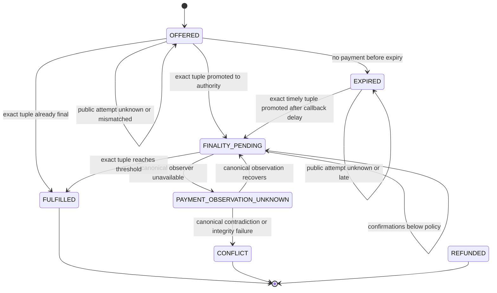

# Architecture

## Control boundary

OrderSeal does not trust the browser to declare payment success. The browser may request a wallet transaction and submit the returned hash, but only the persistent observer can authorize fulfilment. The observer reads mainnet state separately from the wallet callback through one configured, trusted RPC and compares it with server-sealed terms.

The unavoidable control point is the fulfilment release stored by the backend. A merchant who delivers outside OrderSeal can bypass the product; OrderSeal does not claim to control external delivery systems.

## Components

1. **React Mini App client** — merchant console and public checkout. It calls the Nimiq Mini App SDK only when a mainnet host provider is present.
2. **Vercel API proxy** — forwards same-origin `/api/*` requests to the persistent backend. It stores no order state.
3. **Fastify observer** — authenticates merchant operations, seals terms, records deduplicated public attempts, promotes only an exact chain match to payment authority, and applies state transitions.
4. **SQLite evidence store** — runs in WAL mode on a Railway volume. It stores immutable terms, canonical operations, observations, audit events, and fulfilment records.
5. **Nimiq JSON-RPC** — authoritative read source for transaction and head-block evidence. The client-reported hash is only a lookup key.

## Server-authenticated order seal

The HMAC-sealed canonical payload contains:

- order ID, code, and revision;
- item name and description;
- normalized mainnet recipient;
- exact amount in Luna;
- asset and network;
- expiry;
- fulfilment reference and SHA-256 digest of the protected fulfilment message;
- merchant configuration revision;
- compact operation reference placed in recipient data.

This is a server-authenticated seal, not a public-key merchant signature. Its purpose is detecting database or workflow mutation inside this deployment. The signing secret must remain outside the repository.

Before a payment claim and again inside the reconciliation apply transaction, OrderSeal verifies the HMAC, schema, every duplicated immutable order column, and fulfilment digest. A mismatch fails closed and cannot create a fulfilment.

## State machine

`FULFILLED`, `REFUNDED`, and `CONFLICT` are immutable. `EXPIRED` can accept a callback because transaction time, not callback time, determines whether a payment was timely.

## Integrity and concurrency invariants

1. Public transaction hashes are deduplicated `PAYMENT_ATTEMPT` evidence. Unknown or mismatched attempts do not mutate order payment authority or terminal state.
2. At most one exact-match `PAYMENT_OBSERVATION` authority exists per order. A partial unique index enforces this at the database boundary.
3. A transaction hash is canonical for at most one order because `orders.payment_tx_hash` is unique.
4. At most one fulfilment exists per order and semantic fulfilment key.
5. State changes use the current row version and exclude immutable terminal states.
6. Reconciliation re-reads order and operation state inside the apply transaction after the RPC await.
7. Same-hash attempts reuse one evidence record. Different hashes may be observed until one exact match claims authority; after that, alternatives are rejected and audit-preserved.
8. Every accepted idempotency key, including same-hash aliases, is durably bound to one transaction payload.
9. Arbitrary public attempts are not placed in the background observer queue. The originating checkout may explicitly retry its saved attempt; only canonical authority is retried by the server interval.
10. A timeout or missing observation is uncertainty, not proof of failure and not permission for the same checkout to issue a blind second payment.
11. Fulfilment is inserted in the same transaction that makes the order fulfilled and the authority applied.

## Confirmation policy

`NIMIQ_REQUIRED_CONFIRMATIONS` is an operator safety policy, defaulting to 10 and constrained to 2–120. The observer takes the smaller of the RPC-reported confirmation count and the count derived from the current head. This is not a claim that every merchant has the same risk threshold.

Nimiq RPC timestamps are interpreted as Unix seconds, with defensive support for millisecond providers, before comparison with the signed ISO expiry.
